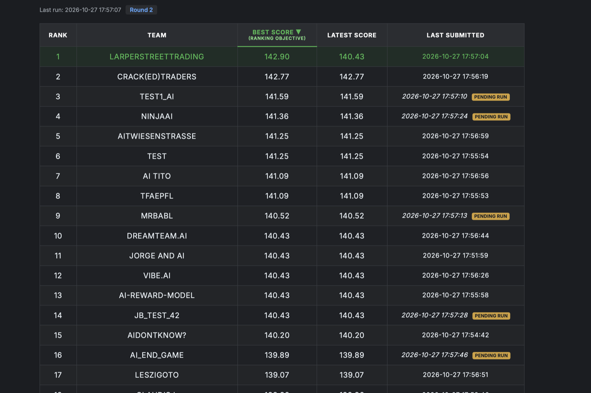

# G-Research-Main

Team repository of **LarperStreetTrading** for the **G-Research Quant Challenge** (ETH Zürich,
27 October 2026). The event was a three-round Python **Trading Game**: each turn a reward is
offered, and accepting it locks the team out for the next 15 turns. We **won Round 2**.

Before the briefing the format was unknown, so the repository also holds the cointegration /
pairs-trading kit and the overfitting gates we prepared for that case (see *Event-day kit* below).

## Results

**Round 2: 1st place** with a best score of **142.90**, ahead of Crack(ed)Traders (142.77) and
test1_AI (141.59).



| Round | Game | Ranked on | Our strategy | Result |
|---|---|---|---|---|
| 1 | Accept or skip a reward each turn (2,000 turns, 15-turn lockout); rewards Exponential(mean 10) | Best score | Exact finite-horizon optimal stopping (backward dynamic programming) | Top 4, best 2,964.44 |
| 2 | Same game, hidden reward distribution | Best score | Same dynamic program on a distribution learned online, with an N(0, 1) prior | **1st, best 142.90** |
| 3 | Exclusive claims: if two or more teams accept on the same turn, all score zero | Latest score | Claim a band of mid-sized rewards | See [EVENT_STRATEGIES.md](EVENT_STRATEGIES.md) |

### How the Round 2 strategy works

[`submissions/event/round2_v6_normal_prior.py`](submissions/event/round2_v6_normal_prior.py):

- **Optimal stopping.** With lockout `L`, the acceptance threshold for turn `t` is the value lost
  by being locked out: `c[t] = V[t+1] - V[t+L+1]`, where `V[t] = V[t+1] + E[(r - c[t])+]` is
  solved backwards from the last turn. Accept iff `reward >= KAPPA * c[t]`.
- **Learning the hidden distribution.** Every reward is observed, including while locked out.
  The estimate is shrunk towards N(0, 1) (300 pseudo-observations), which earlier runs had
  confirmed. The prior switches off automatically if the data disagrees.
- **Ranking-aware risk.** Round 2 ranked teams on their *best* run, so `KAPPA = 1.05` is slightly
  pickier than the risk-neutral optimum. That adds variance and raises the expected best score.
- **Safety.** It detects lag-1 autocorrelation and switches to a state-dependent dynamic program.
  It never accepts a non-positive reward, and it never raises.

To run it with the organisers' client:

```bash
git clone https://github.com/ajaykm3/gr_tradinggame_client && cd gr_tradinggame_client && uv sync
cp ../G-Research-Main/submissions/event/round2_v6_normal_prior.py solution.py
uv run python test.py
```

## Documents

| File | What it is |
|---|---|
| [EVENT_STRATEGIES.md](EVENT_STRATEGIES.md) | Trading Game strategies for all three rounds, what failed, and lessons |
| [WINNING.md](WINNING.md) | Practical decision guide for the event + review of our tooling with confirmed defects to fix (§8) |
| [PLAYBOOK.md](PLAYBOOK.md) | Intelligence on the event and comparable competitions, strategy math, bot exploits, event-day runbook |
| [PLAN.md](PLAN.md) | Build plan: backtest engines, strategy library, submission tooling, timeline to the event |
| [RULES.md](RULES.md) | Binding process rules: protected `main`, PR review, research integrity, submission safety |
| [AGENTS.md](AGENTS.md) | Instructions for any AI coding agent: setup, commands, layout, git/code rules |
| [CLAUDE.md](CLAUDE.md) | Claude Code specifics (imports AGENTS.md): guard hook, MCPs, skills |

## Getting started

```bash
git clone https://github.com/GresearchHereMe/G-Research-Main.git
cd G-Research-Main
git config core.hooksPath .githooks        # blocks local commits/pushes to main
uv sync && uv run pytest -q
```

Requirements: Python ≥ 3.11, [uv](https://docs.astral.sh/uv/), `gh` CLI for PRs.

## Event-day kit

No trading logic is fixed in advance. Pipeline (full version: [AGENTS.md](AGENTS.md) §5):
**observe → prototype → gates G0–G4 → port to skeleton → replay → submit**.

```bash
uv run python scripts/diagnose.py data/round1.csv                         # S0 observe
cp templates/research_template.py research/idea1.py                       # S1 prototype
uv run python scripts/evaluate_algo.py research/idea1.py data/round1.csv  # S2 GO / NO-GO + size
uv run python scripts/replay_skeleton.py submissions/r1-v1.py data/round1.csv   # S3 check port
```

Pairs-specific tools (use only if the data is a pairs game):

```bash
uv run python scripts/make_practice_data.py data/practice_synth.csv     # rehearsal data
uv run python scripts/screen_pairs.py data/practice_synth.csv           # rank pairs; verdict column
uv run python scripts/sweep_pair.py data/practice_synth.csv --y AAA --x BBB   # plateau params + OOS
uv run python scripts/make_submission.py --config submissions/example_config.json \
    --out submissions/round1-v1.py                                      # stdlib-only single file
```

The generated file exposes `on_tick(prices) -> target positions` and `to_orders(targets,
positions)`; adapt only its bottom ADAPTER block to the platform's interface. Optional config
keys: `"size_fraction"` (GO 1.0 / GO-REDUCED 0.5, scales every target) and `"flatten_after"`
(tick count from which all targets are zero). The skeleton has the same via `target_orders()`,
`RISK["flatten_after"]`, and `step()` (orders) / `step_targets()` (positions).
Briefing answers go in [research/event-notes.md](research/event-notes.md).

## Workflow (short version of RULES.md)

1. `git switch main && git pull --ff-only && git switch -c feat/<topic>`
2. Write a failing test, make it pass, keep commits conventional (`feat: …`, `fix: …`).
3. `git push -u origin feat/<topic>` and `gh pr create` using the PR template.
4. A teammate who is **not the author** reviews and merges. Never merge your own PR.

## Status

| Phase | State |
|---|---|
| Guardrails, playbook, plan | merged (#1, #3) |
| Event-day kit: core trader, stats, backtester, sweep, submission builder | merged (#2) |
| Overfitting gates (PBO, DSR, G0–G5) and review fixes | merged (#4, #7, #8, #12) |
| Trading Game strategies, rounds 1–3 | merged (#13) |
| Event, 27 October 2026 | **Round 2 won** |

## Layout

```
.claude/        settings.json + hooks/guard_main.py (agent guard)
.githooks/      pre-commit, pre-push (human guard)
.github/        CI workflow, PR template
tests/          pytest suite
src/gqc/        engine + strategies (from P1)
research/       notebooks, event notes
submissions/    frozen single-file submissions; event/ holds the Trading Game strategies
docs/img/       result screenshots
```
